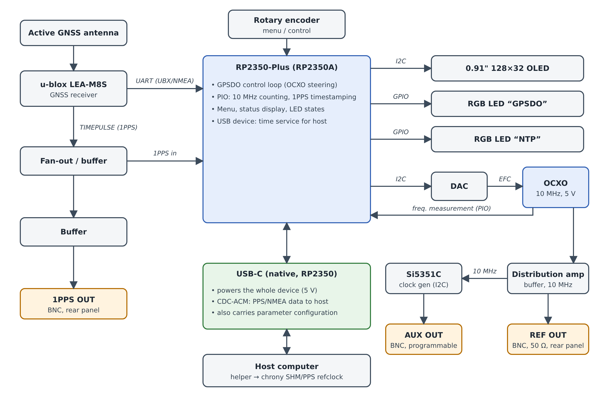

# HamREF

A small GNSS-disciplined 10 MHz frequency reference and precision time server for the amateur radio shack — built around the u-blox LEA-M8S GNSS module.

> **Status: early architecture / pre-prototype.** Proto-1 schematic and PCB (v0.1) are generated and routed, not yet built or tested; a firmware proof of concept (PIO counter + disciplining loop, host-simulated, not yet run on hardware) is in [`firmware/`](firmware/). This README documents the design as currently planned so the repo has a real starting point; sections below are marked `TODO` where work hasn't started.

<p align="center">
  
</p>

<p align="center">
  <br>
  <em>Proto-1 bring-up board (v0.1): 4-layer, 100 × 80 mm (fits the Fischer AKG 105.26 case grooves), 3D view from KiCad. Design files in <a href="hardware/proto-v0.1/"><code>hardware/proto-v0.1/</code></a>.</em>
</p>

## What this is

HamREF provides two things a well-equipped station needs and usually has to buy separately:

- A **10 MHz reference output** (BNC, 50 Ω) to lock transceivers, synthesizers, and test equipment, plus a **programmable AUX output** for other frequencies (e.g. 25 MHz, 27 MHz for satellite LNBs, 40 MHz for a Pluto SDR, or an arbitrary frequency).
- A **1 PPS timing output** which can be used to lock and synck devices to the world-standard one pulse per second.
- A **precision time source for the shack computer**, disciplined by GNSS, accurate enough for FT8 and other digital modes.

Status (GNSS lock, satellite count, PPS accuracy, OCXO discipline state) is shown on a small monochrome OLED plus two multicolor status LEDs (GPSDO / NTP) on the front panel — color and blink/steady pattern indicate different states. A front-panel rotary encoder drives the menu; full parameter configuration is also available over USB (see [Enclosure](#enclosure) below).

## Why not just use the GNSS module's own 10 MHz output?

The LEA-M8S can output a configurable timepulse from 0.25 Hz to 10 MHz directly, but that signal is a digitally synthesized pulse train (derived from the module's internal TCXO + fractional-N synthesizer), not a clean analog oscillator. At 10 MHz its jitter (the module's spec is 30 ns RMS / 60 ns 99% at 1 Hz) is significant relative to the 100 ns period, it can show small phase steps at each second boundary, and it provides no holdover if GNSS lock is lost.

HamREF instead uses the classic GPSDO approach: the LEA-M8S's single TIMEPULSE output is configured as **1PPS**, and that one pulse-per-second reference is used by the MCU to discipline a separate free-running OCXO via a DAC-driven EFC loop with a long time constant. The 10 MHz output comes from the OCXO itself — far lower phase noise, plus holdover if satellite lock drops. The same 1PPS/NMEA data feeds the time service to the host computer.

Full rationale and the architecture decision log: [`docs/architecture-and-plan.md`](docs/architecture-and-plan.md) (in Finnish).

## Enclosure

**Fischer Elektronik AKG 105.26** (part AKG1052680ME) — an extruded aluminum mini case for 100 mm eurocards, 105 × 100.3 × 26 mm, natural anodized, with integrated cooling-fin channels. Front and rear panels are separate 2 mm cover plates.

The 26 mm case height (≈22 mm usable panel height) ruled out the originally planned 240x240 color TFT. An EC11-class rotary encoder does fit, though (body ≈11.7×12–13×4.5–8.5 mm, ø7 mm panel bushing — verified against the Farnell EC11 datasheet), so the front panel keeps a physical control after all:

| Panel | Contents |
|---|---|
| Front | 0.91" 128x32 OLED (status), 2 multicolor LEDs (GPSDO, NTP), rotary encoder (menu/control) |
| Rear | SMA (GNSS antenna), BNC (1PPS OUT), BNC (REF OUT 10 MHz), BNC (AUX OUT, programmable), USB-C (host + 5V power) |

The 22 mm limit also constrains component height on the PCB (OCXO included) — still an open item, see the architecture doc.

## Architecture overview

<p align="center">
  <br>
  <em>Block diagram (editable source: <a href="docs/images/HamREF-architecture.svg"><code>HamREF-architecture.svg</code></a>).</em>
</p>

The GNSS module's 1PPS (TIMEPULSE) disciplines the OCXO through the MCU: the RP2350 measures the 10 MHz against the PPS with PIO and steers the EFC through the DAC. REF OUT (10 MHz) comes from the OCXO itself, 1PPS OUT from the GNSS TIMEPULSE, and AUX OUT is a programmable output (Si5351C clocked from the OCXO).

**What is the USB-C port, in plain words?** It is a normal USB-C connector (USB 2.0 only, no Power Delivery, so always 5 V) wired straight to the RP2350's own USB controller. One cable does two jobs: it powers the whole device and it carries data. The data side is a **virtual serial port over USB** (class CDC-ACM): the computer sees an ordinary serial port (`COMx` on Windows, `/dev/ttyACM0` on Linux, `/dev/cu.usbmodem…` on macOS) and needs no special driver. Over that port the device sends the GNSS text sentences and PPS timing data to a small helper program on the computer, which feeds chrony; the computer can also send configuration commands back.

| Acronym | Meaning |
|---|---|
| GNSS | Global Navigation Satellite System: GPS, Galileo, GLONASS, BeiDou |
| 1PPS / PPS | One Pulse Per Second: a pulse aligned to the start of each UTC second |
| TIMEPULSE | u-blox name for the LEA-M8S's programmable timing-pulse output (here set to 1PPS) |
| UART | Universal Asynchronous Receiver/Transmitter: the simple serial link between LEA-M8S and RP2350 |
| NMEA | Text sentences (`$GPGGA`, `$GPRMC` …) in which GNSS receivers report time, position and satellites |
| UBX | u-blox's own binary protocol, used to configure the LEA-M8S |
| USB VBUS | The 5 V power line of a USB cable |
| CDC-ACM | USB Communications Device Class, Abstract Control Model: the standard way to make a USB device look like a serial port |
| PD | USB Power Delivery: negotiation of voltages above 5 V (not used here) |
| I2C | Two-wire bus used for the OLED, the DAC and the Si5351C |
| GPIO | General-purpose input/output pin (drives the status LEDs, reads the encoder) |
| PIO | Programmable I/O: the RP2350's small hardware state machines that count the 10 MHz and timestamp the PPS without CPU jitter |
| OCXO | Oven-Controlled Crystal Oscillator: a crystal kept at constant temperature, the source of the 10 MHz |
| EFC | Electronic Frequency Control: the analog voltage input that fine-tunes the OCXO's frequency |
| DAC | Digital-to-Analog Converter: turns the MCU's number into the EFC voltage |
| SHM | Shared Memory: one of chrony's reference-clock interfaces, where the host helper hands over the timestamps |
| chrony | The time-sync daemon on Linux/macOS that disciplines the computer's clock (an NTP implementation) |
| NTP | Network Time Protocol |

Key hardware decisions so far:

| Item | Decision | Notes |
|---|---|---|
| GNSS module | u-blox LEA-M8S | Fixed — parts already on hand. Footprint and pinout are shared with LEA-M8T. |
| Antenna | Active, external | Antenna supervisor + R_BIAS per u-blox HIM. |
| MCU | RP2350A on a ready-made Raspberry Pi Pico 2 board | Ready-made board keeps HamREF easy to build as a kit. PIO blocks give deterministic 10 MHz counting and 1PPS timestamping without WiFi interrupt jitter; native USB (TinyUSB); UF2 firmware updates. No WiFi in v1. Raspberry Pi Pico 2 (micro-USB) remains a fallback. |
| Oscillator | 5 V OCXO, analog EFC (CTI OSC5A2B02 selected for the prototype) | e.g. Trimble 65256 / IsoTemp 143-141 / CTI OC5SVC25 / Bliley NV47M1008 class part — physical height inside the 22 mm case is still open, see architecture doc. |
| Enclosure | Fischer Elektronik AKG 105.26 (AKG1052680ME) | 105 × 100.3 × 26 mm extruded aluminum, 100 mm eurocard. |
| Display | 0.91" 128x32 mono OLED, I2C | SSD1306-class, 38 × 12 mm PCB (active area 22.4 × 5.6 mm) — fits the 22 mm panel height with margin; 0.96" 128x64 modules do not. |
| Front panel | OLED + 2 multicolor LEDs (GPSDO, NTP) + rotary encoder | EC11-class encoder confirmed to fit the 22 mm panel height. LED color/blink pattern encodes state (firmware TBD). |
| Rear panel | SMA (GNSS antenna), BNC (1PPS OUT), BNC (REF OUT 10 MHz), BNC (AUX OUT, programmable), USB-C (host + 5V power) | All connectors on the back; layout across the 105 mm width still to be confirmed at PCB stage. |
| Power + host link | USB-C | Powers the device (5V); CDC-ACM carries PPS/NMEA to a host-side helper feeding chrony (SHM/PPS refclock), and doubles as the configuration interface alongside the encoder/OLED menu. |

See the architecture doc for the full reasoning, open questions, and the phased project plan.

## Status / roadmap

- [x] Requirements and architecture defined
- [x] Enclosure selected (Fischer AKG 105.26) and display/panel layout locked to it
- [x] MCU selected (RP2350 / Pico 2)
- [ ] Proto-PCB v0.1 (bring-up board, see architecture doc)
- [ ] Breadboard proof of concept (PIO PPS capture + frequency counting, disciplining loop, USB time delivery)
- [ ] KiCad schematic
- [ ] PCB layout
- [ ] Enclosure machining (panel cutouts)
- [x] Firmware proof of concept (PIO gate counter, disciplining loop, host simulation) - see [`firmware/`](firmware/)
- [ ] Firmware on real hardware (calibration, OLED/menu, GNSS configuration, host helper)
- [ ] Calibration and verification against a reference

## Repository structure

```
hardware/proto-v0.1/   KiCad project (schematic, PCB) for the proto-1 board
hardware/tools/        Python scripts that generate the schematic/PCB
firmware/              RP2350 firmware (Pico SDK) and host simulation
docs/                  Architecture notes, hardware plans, images
```

## Building it yourself

Firmware: see [`firmware/README.md`](firmware/README.md) (Pico SDK, CMake, UF2). The disciplining loop can be tried without hardware with the host simulation described there. Hardware: open `hardware/proto-v0.1/` in KiCad; the pre-order checklist is in [`docs/hardware/board-finishing-checklist.md`](docs/hardware/board-finishing-checklist.md). A bill of materials and bring-up guide will follow once the board is built.

## Hardware reference documents

Design decisions are based on:
- u-blox LEA-M8S Data Sheet (UBX-16010205)
- u-blox LEA-M8S/M8T Hardware Integration Manual (UBX-15030060)
- Fischer Elektronik AKG1052680ME data sheet (enclosure)
- Raspberry Pi RP2350 datasheet and Waveshare RP2350-Plus schematic / STEP model (`docs/datasheets/`)

## License

Not chosen yet (candidates: CERN-OHL-S for hardware, MIT or GPL for firmware, CC BY-SA for docs). Until a license is added, all rights are reserved.

## Authors

Erik, OH2LAK
Others will be too, when I find them and convince them this is a good project :)
